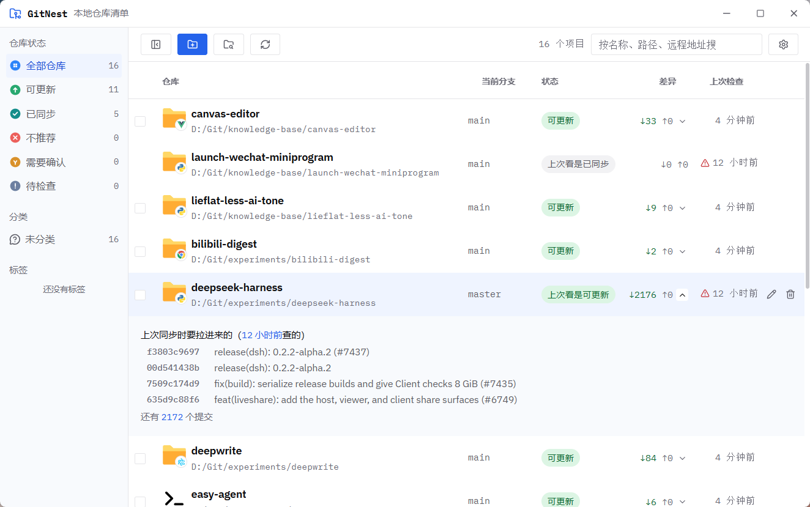

# git-nest

把散在本机各处的 git 仓库收进一张表：每个仓库**现在什么状态、落后远程多少、推不推荐更新**，
一目了然；勾选好之后**批量更新**。有 Windows / macOS / Linux 的桌面安装包（Tauri 2），
也可以完全在浏览器里用。

- **本地优先**：扫描目录、读状态、渲染 README 全在本机做，清单存在本机 SQLite。
- **联网只做一件事**：fetch 远程引用（你按「联网检查更新」，或服务端定时一轮；
  只动 `refs/remotes/*`，绝不碰工作区，每条命令都进命令日志）。
- **更新永远由你勾选触发**，且只做 fast-forward——不产生 merge commit，绝不动你的工作区。
- 分类、标签、备注、README 预览，都是为了让这张表几年后还看得懂。



## 快速开始

需要 **Node ≥ 22** 与 **pnpm**（pnpm workspace）。

```bash
pnpm install
pnpm dev            # 同时起服务端与界面
```

| | 地址 | 能不能改 |
|---|---|---|
| 界面（Vite） | http://localhost:36378 | `GIT_NEST_API`（Vite 代理指向哪） |
| 本机 API（Fastify） | http://127.0.0.1:36379 | `GIT_NEST_PORT`；跨站白名单用 `GIT_NEST_CORS` |

端口默认值只在 `packages/core/src/types.ts` 的 `DEFAULT_PORTS` 里写一次，两端都读它——
改端口只改那一处。开发数据存在 `data/git-nest.db`（不进版本库）。

## 桌面应用（Tauri 2）

壳在 `src-tauri/`，能出 MSI / NSIS 安装包。开发时开两个终端：

```bash
pnpm dev              # 终端 1：界面（36378）+ API（36379）
pnpm desktop:dev      # 终端 2：打开 git-nest 窗口
```

打包形态不需要 Node、不需要终端，双击即用：

```bash
pnpm desktop:release  # 编 release + 铺资源，**不打安装包**；产物直接可跑
pnpm desktop:build    # 同上，并出 MSI / NSIS 安装包
```

打包后数据（数据库 + WebView2 用户数据 + 日志）放在 **exe 旁边的
`git-nest-data/`**——便携版整个目录拷走即用。实现细节、CSP、权限模型见
[`src-tauri/README.md`](src-tauri/README.md)；Node 服务怎么随包分发见
[`src-tauri/SIDECAR.md`](src-tauri/SIDECAR.md)。

## 常用脚本

```bash
pnpm dev:server     # 只起 API
pnpm dev:web        # 只起界面
pnpm typecheck      # 三个包各跑一遍
pnpm test           # 全量测试
pnpm build          # 构建
pnpm bench:status   # 掐一次「读状态」的耗时（见 docs/LIST-SCALE.md）
pnpm check:encoding # 检查编码（有几个刻意的 fixture 会被报出来，属正常）
```

## 技术栈与源码结构

```
apps/server    Fastify + better-sqlite3；算状态、存清单、跑 git（本机 HTTP 服务）
apps/web       React + Vite；只渲染服务端算好的结论
packages/core  两端共用的类型、schema、常量（浏览器安全那份在这里）
src-tauri      Tauri 2 桌面壳（Rust）；dev 只提供窗口，打包时负责拉起 Node 服务
```

## 文档

- [`docs/软件定位.md`](docs/软件定位.md)——**是什么、不是什么**（这份是定位的正本）
- [`docs/DESIGN.md`](docs/DESIGN.md)——设计原则与界面约定（"为什么这么做"的正本）
- [`docs/TAURI-PITFALLS.md`](docs/TAURI-PITFALLS.md)——**桌面壳避坑指南**（事故清单，与具体项目解耦；做同类结构的项目前扫一遍）
- [`docs/ARCHITECTURE-REVIEW.md`](docs/ARCHITECTURE-REVIEW.md)——架构评审（解耦 / 边界 / 语义的候选清单）
- [`docs/DETAIL-OVERLAY.md`](docs/DETAIL-OVERLAY.md)——详情浮层的方案备案
- [`docs/LIST-SCALE.md`](docs/LIST-SCALE.md)——列表规模（分页 / 虚拟化）的方案备案
- [`src-tauri/README.md`](src-tauri/README.md)——桌面壳的现状正本（命令、CSP、数据目录、安装位置）
- [`src-tauri/SIDECAR.md`](src-tauri/SIDECAR.md)——Node 服务随包分发的实现与验证记录
